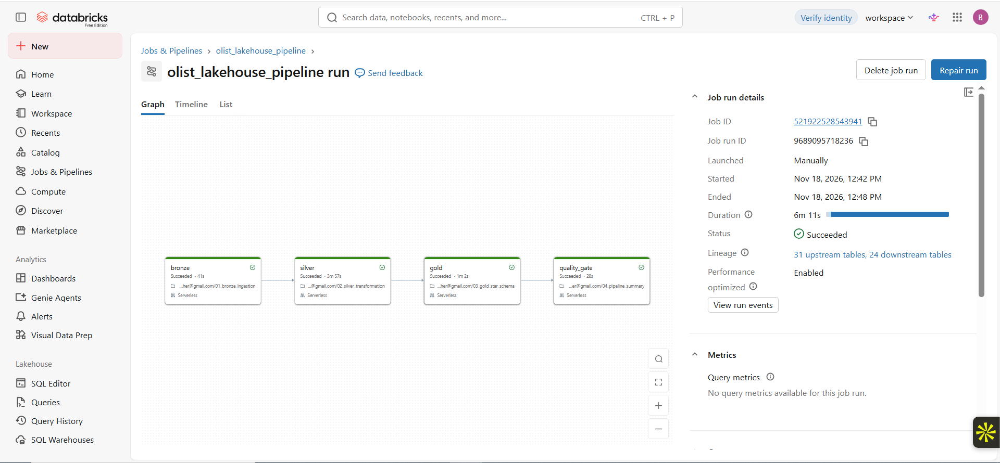
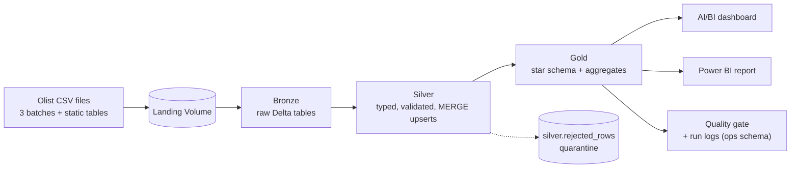
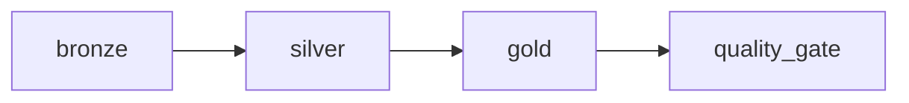
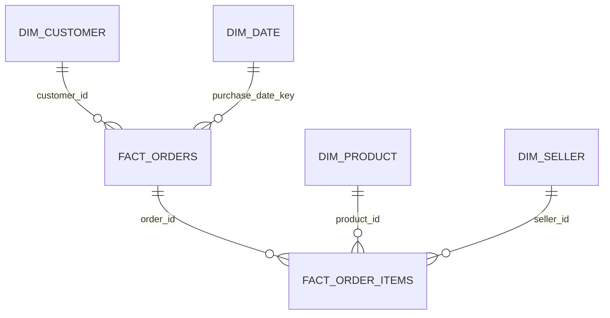
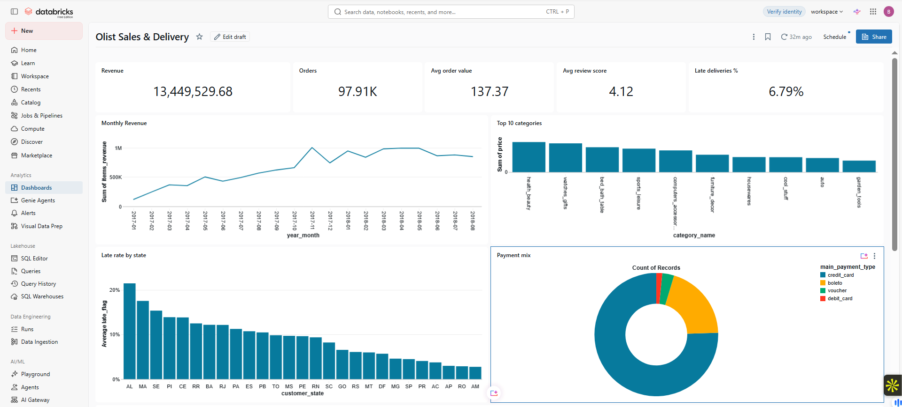
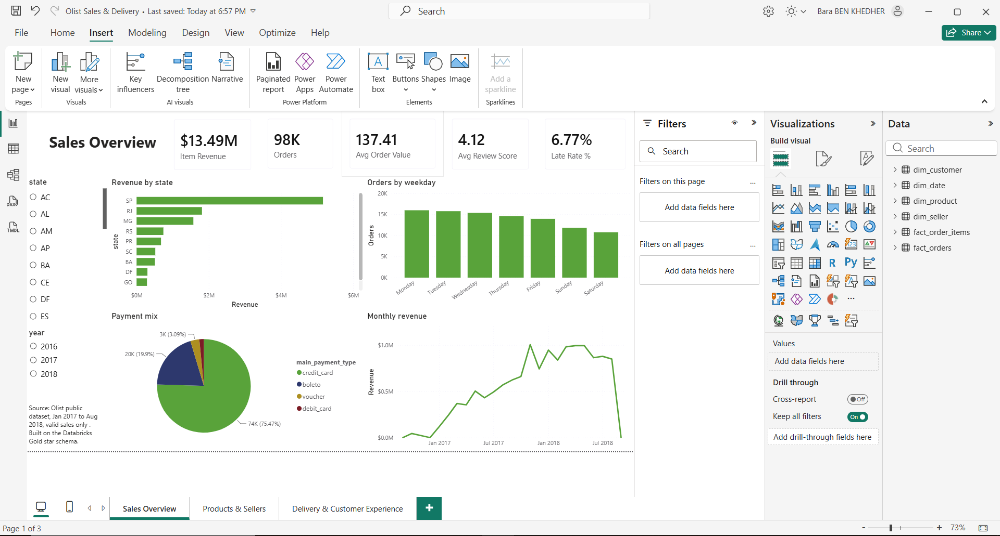
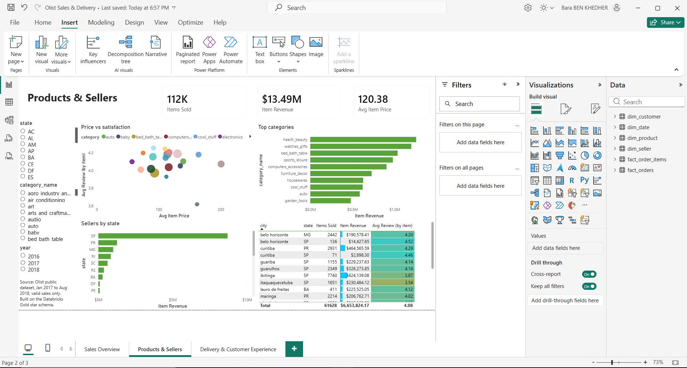
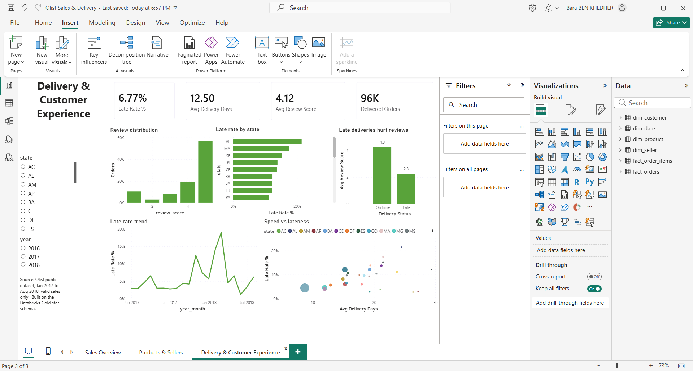
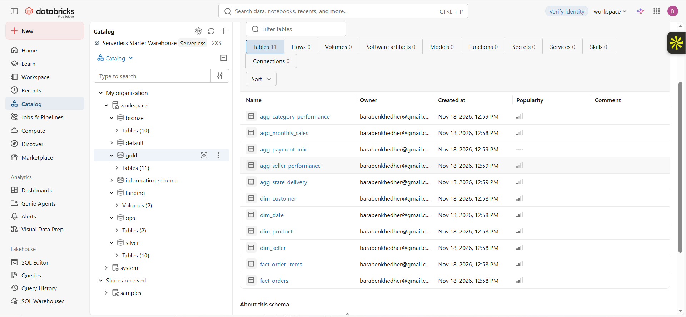

# Olist Lakehouse on Databricks


An end-to-end data engineering project: a **medallion lakehouse (Bronze / Silver / Gold)** built with **PySpark and Delta Lake** on **Databricks Free Edition**, orchestrated with a **Databricks Job**, protected by a **data quality gate**, covered by **pytest unit tests and GitHub Actions CI**, and delivered through a **Databricks AI/BI dashboard** and a **Power BI report**.

It processes the public [Olist Brazilian e-commerce dataset](https://www.kaggle.com/datasets/olistbr/brazilian-ecommerce) (about 100,000 orders) from raw CSV files to business-ready analytics.



---

## TL;DR for recruiters (2-minute tour)

| If you want to see... | Look at |
|---|---|
| The whole pipeline running green | [`docs/job_run_graph.png`](docs/job_run_graph.png) and [`jobs/olist_pipeline_job.yml`](jobs/olist_pipeline_job.yml) |
| How raw data is ingested | [`notebooks/01_bronze_ingestion.py`](notebooks/01_bronze_ingestion.py) |
| Data cleaning, quality rules, quarantine, `MERGE` upserts | [`notebooks/02_silver_transformation.py`](notebooks/02_silver_transformation.py) and [`notebooks/olist_transforms.py`](notebooks/olist_transforms.py) |
| The dimensional model (star schema) | [`notebooks/03_gold_star_schema.py`](notebooks/03_gold_star_schema.py) |
| Run logging and the quality gate | [`notebooks/04_pipeline_summary.py`](notebooks/04_pipeline_summary.py) |
| Delta Lake features (time travel, restore, constraints, optimize) | [`notebooks/05_delta_features_demo.py`](notebooks/05_delta_features_demo.py) |
| Unit tests and CI | [`tests/`](tests/) and [`.github/workflows/ci.yml`](.github/workflows/ci.yml) |
| The business results | [Dashboards](#8-dashboards) and [Key findings](#9-key-findings) |

**What this project demonstrates**

- Medallion architecture with incremental, idempotent ingestion (re-running a batch never creates duplicates)
- Schema enforcement, data quality rules and a **quarantine table** (bad rows are never silently dropped)
- Delta Lake `MERGE INTO` upserts, time travel, `RESTORE`, `CHECK` constraints and `OPTIMIZE`
- Dimensional modeling: 4 dimensions, 2 fact tables and 5 aggregate tables
- Orchestration with task dependencies, job parameters, run logging and a quality gate that fails the run on bad data
- Testable pipeline code: the cleaning logic is shared between the pipeline and the unit tests
- BI delivery: Databricks AI/BI dashboard and a 3-page Power BI report built on the same Gold model

---

## Table of contents

1. [Project overview](#1-project-overview)
2. [Architecture](#2-architecture)
3. [Dataset](#3-dataset)
4. [Layer details](#4-layer-details)
5. [Orchestration and observability](#5-orchestration-and-observability)
6. [Delta Lake features demonstrated](#6-delta-lake-features-demonstrated)
7. [Testing and CI](#7-testing-and-ci)
8. [Dashboards](#8-dashboards)
9. [Key findings](#9-key-findings)
10. [Repository structure](#10-repository-structure)
11. [How to run it](#11-how-to-run-it)
12. [Design decisions and trade-offs](#12-design-decisions-and-trade-offs)
13. [Limitations](#13-limitations)
14. [Next steps](#14-next-steps)
15. [Skills demonstrated](#15-skills-demonstrated)
16. [About me](#16-about-me)

---

## 1. Project overview

**Goal:** turn raw e-commerce CSV files into trustworthy, analytics-ready tables, and answer three business questions:

1. How is the business performing (revenue, orders, average order value, payment methods)?
2. Which products and sellers drive the revenue?
3. How good is delivery performance, and what does late delivery cost in customer satisfaction?

**Approach:** the data is loaded in three batches (to simulate data arriving over time) into a Bronze / Silver / Gold lakehouse on Databricks, with automated validation at each step and a Job that runs the whole pipeline end to end.

**Tech stack:** Databricks Free Edition (serverless compute, Unity Catalog, Volumes, Jobs, AI/BI dashboards), PySpark, Delta Lake, SQL, Python, pytest, GitHub Actions, Power BI (DAX).

---

## 2. Architecture



| Layer | Schema | Purpose | Write pattern |
|---|---|---|---|
| Landing | `workspace.landing` (Volume `raw`) | Raw CSV files, split into `static` and `batch_1..3` | Uploaded files |
| Bronze | `workspace.bronze` | Raw data as received, plus lineage metadata | Append per batch (static tables overwritten once) |
| Silver | `workspace.silver` | Typed, cleaned, validated, deduplicated | `MERGE INTO` upserts (static tables rebuilt) |
| Gold | `workspace.gold` | Star schema and business aggregates | Full rebuild from Silver |
| Ops | `workspace.ops` | Row counts per layer and quality gate results per run | Append |

**Orchestration:** one Databricks Job with four dependent tasks.



---

## 3. Dataset

[Brazilian E-Commerce Public Dataset by Olist](https://www.kaggle.com/datasets/olistbr/brazilian-ecommerce) on Kaggle (see the dataset page for license terms). The raw files are not stored in this repo.

| Table | Rows | Notes |
|---|---|---|
| orders | 99,441 | Order header and status timeline |
| order_items | 112,650 | One row per item sold |
| order_payments | 103,886 | One or more payments per order |
| order_reviews | 99,224 | Review comments contain line breaks (needs special CSV handling) |
| customers | 99,441 | `customer_id` is one id per order; `customer_unique_id` identifies the person |
| products | 32,951 | Category names in Portuguese |
| sellers | 3,095 | |
| geolocation | 1,000,163 | Many GPS points per zip code prefix |
| category_translation | 71 | Portuguese to English category names |

**Simulating arriving data:** `scripts/split_olist.py` splits the order-related tables into 3 batches of 33,147 orders each (by purchase date). Reference tables are loaded once.

---

## 4. Layer details

### Bronze: raw but traceable ([`01_bronze_ingestion.py`](notebooks/01_bronze_ingestion.py))

- Explicit schemas with all columns kept as `string`: raw fidelity, typing happens in Silver, and a bad value can never be silently turned into `NULL` at ingestion
- Metadata on every row: `source_file`, `batch_id`, `ingestion_ts`
- Review files are read with `multiLine`: without it, review comments with line breaks are split into extra rows (batch 1 would load 34,783 rows instead of the correct 33,134)
- **Idempotent:** a log table (`bronze.ingestion_log`) records every loaded `(batch, table)`, so re-running a batch is skipped
- Controlled by a `batch` widget / job parameter: `static`, `batch_1`, `batch_2`, `batch_3` or `all`

### Silver: trusted data ([`02_silver_transformation.py`](notebooks/02_silver_transformation.py), [`olist_transforms.py`](notebooks/olist_transforms.py))

- **Safe casting:** `try_*` functions turn unparseable values into `NULL` instead of crashing the job (important under ANSI SQL mode), and the quality rules then reject those rows
- **Standardization:** trimmed text, lower-case statuses and cities, upper-case states, English product categories (with fallbacks for untranslated and missing categories), fixed column typos (`lenght` to `length`)
- **Data quality rules per table** (for example valid order status, non-negative prices, review score between 1 and 5, valid payment types, GPS points inside Brazil)
- **Quarantine:** rows failing any rule go to `silver.rejected_rows` with the failed rule names and the original raw row as JSON
- **Deduplication** on the business key (latest Bronze load wins)
- **Upserts:** `MERGE INTO` for transactional tables, so re-processing a batch updates rows instead of duplicating them
- **Geolocation** is aggregated from 1,000,163 GPS points to one row per zip code prefix (average coordinates, most frequent city): 19,010 rows after rejecting 40 points outside Brazil
- **Run log:** `silver.silver_log` records rows in, rejected, duplicates removed, inserted and updated per table and run
- **Reconciliation:** every Bronze row is accounted for (kept, rejected or removed as duplicate)

The cleaning functions live in a shared notebook (`olist_transforms`) loaded with `%run`, so the pipeline and the unit tests use exactly the same code.

### Gold: star schema ([`03_gold_star_schema.py`](notebooks/03_gold_star_schema.py))



| Table | Grain / purpose | Rows |
|---|---|---|
| `dim_date` | One row per calendar day | 800 |
| `dim_customer` | One row per `customer_id`, with coordinates | 99,441 |
| `dim_seller` | One row per seller, with coordinates | 3,095 |
| `dim_product` | One row per product, English category, volume | 32,951 |
| `fact_orders` | One row per order: totals, payments, latest review, delivery days, late flag | 99,441 |
| `fact_order_items` | One row per item sold | 112,650 |
| `agg_monthly_sales` | Orders, revenue, customers, reviews by month | 24 |
| `agg_category_performance` | Revenue, price and reviews by category | 74 |
| `agg_state_delivery` | Delivery days and late rate by customer state | 27 |
| `agg_seller_performance` | Revenue, reviews and late rate by seller | 3,053 |
| `agg_payment_mix` | Payments by month and payment type | 87 |

Business definitions: a **valid sale** is an order that is not `canceled` or `unavailable`. Delivery metrics (days, delay, late flag) are computed for delivered orders only. When an order has several reviews, the most recent one is used.

**Reconciliation to the cent:** Gold item revenue (13,591,643.70), freight (2,251,909.54) and payments (16,008,872.12) match Silver exactly.

---

## 5. Orchestration and observability

The Databricks Job `olist_lakehouse_pipeline` ([definition](jobs/olist_pipeline_job.yml)) runs four notebook tasks on serverless compute: `bronze` then `silver` then `gold` then `quality_gate`. It takes about 6 minutes in Free Edition. A failed task stops everything downstream, so Gold is never rebuilt on bad Silver data.

**Job parameters:** `batch` (default `all`) and `run_id` (`{{job.run_id}}`).

**Observability** ([`04_pipeline_summary.py`](notebooks/04_pipeline_summary.py)):

- `ops.pipeline_run_log`: row counts for every table in every layer, per run
- `ops.pipeline_check_log`: results of the quality gate, per run

**Quality gate:** seven checks run after every build. If any fails, the notebook raises an error and the Job run is marked failed.

1. Gold orders count equals Silver
2. Gold items count equals Silver
3. Revenue reconciles to the cent
4. `fact_orders` key is unique
5. `fact_order_items` key is unique
6. No order item without its order
7. Rejected rows stay below 1% of Bronze rows

**Idempotency:** the whole Job can be re-run safely. Bronze skips loaded batches, Silver updates instead of inserting, Gold is rebuilt, and row counts stay the same.

---

## 6. Delta Lake features demonstrated

[`05_delta_features_demo.py`](notebooks/05_delta_features_demo.py) (destructive steps run on a copy, never on the real tables):

- **Time travel:** row count of `silver.orders` at each version, one per batch merge
- **`RESTORE`:** recover a table after an accidental delete
- **Schema enforcement:** a write with the wrong columns is rejected
- **`CHECK` constraint:** the table itself refuses invalid order statuses
- **`OPTIMIZE`:** compacts the small files created by repeated `MERGE` operations

Partitioning is deliberately not used: the tables are small, and partitioning small tables creates many tiny files. For larger tables, liquid clustering (`CLUSTER BY`) is the modern alternative. `VACUUM` was not run, so the default retention is kept.

---

## 7. Testing and CI

- **18 pytest unit tests** ([`tests/test_silver_transforms.py`](tests/test_silver_transforms.py)) run the real Silver logic on small synthetic DataFrames: type casting, text standardization, every category of quality rule (invalid status, unparseable dates, negative prices, review scores outside 1 to 5, GPS points outside Brazil), quarantine content, deduplication with single and composite keys, the geolocation aggregation, and the rule engine itself
- The deduplication tests matter because the real Olist data contains no duplicates, so that logic is proven by the tests rather than by the data
- **GitHub Actions** ([`ci.yml`](.github/workflows/ci.yml)) runs on every push and pull request: Java 17, Python 3.11, PySpark 4.0, syntax check of all notebooks, then the unit tests
- Gold logic and Delta writes are verified at run time by the quality gate in the Job, not by unit tests

Run the tests locally:

```bash
pip install -r requirements-dev.txt   # needs Java 17 or newer
pytest tests -v
```

---

## 8. Dashboards

### Databricks AI/BI dashboard

Built on the Gold tables with three datasets ([`dashboard_datasets.sql`](dashboard_datasets.sql)): KPI counters, monthly revenue, top categories, late rate by state, payment mix and top sellers, with year-month and state filters. Window: January 2017 to August 2018 (the first and last months of the data are incomplete).



### Power BI report (3 pages)

Built on the exported Gold star schema (6 CSV files) with DAX measures and a marked date table.

| Page | Question it answers |
|---|---|
| Sales Overview | How is the business doing? |
| Products & Sellers | What sells, and who sells it? |
| Delivery & Customer Experience | How good is delivery, and what does lateness cost in reviews? |





The report file is in [`powerbi/`](powerbi/).

**Lakehouse tables in Unity Catalog**


---

## 9. Key findings

Window: January 2017 to August 2018, valid sales only. Currency is Brazilian reais (R$).

- **Scale:** R$ 13.45M revenue from 97,910 orders, average order value R$ 137.37, average review score 4.12
- **Late deliveries hurt reviews badly:** orders delivered late average **2.27** stars versus **4.29** for on-time orders
- **Delivery problems are regional and seasonal:** the overall late rate is 6.79% of delivered orders, but Rio de Janeiro and Bahia are above 12% while Sao Paulo is about 4.5%. Late rate spikes in November 2017 (12.4%), February 2018 (14.1%) and March 2018 (19.0%) against a baseline of about 3% in mid-2017
- **Seller concentration:** sellers in the state of Sao Paulo account for about 64% of item revenue
- **Payments:** credit cards are used as the main payment method on about 75% of orders, followed by boleto (about 20%)
- **Top categories by revenue:** health_beauty (R$ 1.25M), watches_gifts (R$ 1.19M) and bed_bath_table (R$ 1.04M)
- **Data quality:** only 40 of about 1.55 million source rows were rejected (0.0026%), all GPS points outside Brazil

---

## 10. Repository structure

```
olist-lakehouse-databricks/
├── README.md
├── requirements-dev.txt          # pyspark + pytest for local tests and CI
├── dashboard_datasets.sql        # the 3 SQL datasets behind the Databricks dashboard
├── .github/workflows/ci.yml      # CI: syntax check + unit tests
├── scripts/
│   └── split_olist.py            # splits the raw CSVs into static + 3 batches
├── notebooks/
│   ├── 00_setup_and_check.py     # schemas, Volume, first data check
│   ├── 01_bronze_ingestion.py    # raw ingestion, idempotent, metadata columns
│   ├── olist_transforms.py       # shared Silver logic (loaded with %run, imported by tests)
│   ├── 02_silver_transformation.py   # cleaning, quality rules, quarantine, MERGE
│   ├── 03_gold_star_schema.py    # dimensions, facts, aggregates, reconciliation checks
│   ├── 04_pipeline_summary.py    # run log and quality gate
│   ├── 05_delta_features_demo.py # time travel, restore, constraints, optimize
│   ├── 06_export_gold_for_powerbi.py # CSV export of the star schema
│   └── 99_reset_lakehouse.py     # optional: drop all tables to rebuild from scratch
├── jobs/
│   └── olist_pipeline_job.yml    # the Databricks Job definition
├── tests/
│   ├── conftest.py
│   └── test_silver_transforms.py
├── powerbi/                      # Power BI report
└── docs/                         # screenshots
```

The notebooks are exported in Databricks source format (`.py` with `# COMMAND ----------` separators), which keeps diffs readable and imports back into Databricks as notebooks.

---

## 11. How to run it

**Prerequisites:** a free [Databricks Free Edition](https://www.databricks.com/learn/free-edition) account, a Kaggle account (to download the dataset), Python 3.11+ with `pandas`, and Git.

### Build the pipeline in Databricks

1. **Get the data.** Clone this repo, download the Olist dataset from Kaggle and unzip the 9 CSVs into a folder named `raw_olist/`.
2. **Split into batches.**
   ```bash
   pip install pandas
   python scripts/split_olist.py      # creates upload/static and upload/batch_1..3
   ```
3. **Import the notebooks.** In Databricks, use Workspace, Create, Import to import every file in `notebooks/` into the same Workspace folder. `olist_transforms` must sit next to `02_silver_transformation` because it is loaded with `%run ./olist_transforms`.
4. **Create the schemas and the Volume.** Run the setup cell in `00_setup_and_check`: it creates the `landing`, `bronze`, `silver` and `gold` schemas and the Volume `workspace.landing.raw`.
5. **Upload the files.** In Catalog, open `workspace.landing.raw`, create the directories `static`, `batch_1`, `batch_2` and `batch_3`, and upload the matching files from `upload/`.
6. **Run the pipeline**, either:
   - **As a Job (recommended):** create a Job with four notebook tasks (`bronze`, `silver`, `gold`, `quality_gate`) as defined in [`jobs/olist_pipeline_job.yml`](jobs/olist_pipeline_job.yml) (replace `<your-email>` in the notebook paths), with job parameters `batch = all` and `run_id = {{job.run_id}}`, and click Run now.
   - **Manually:** run `01_bronze_ingestion`, `02_silver_transformation`, `03_gold_star_schema` and `04_pipeline_summary` in order. For the first two, set the `batch` widget to `static`, `batch_1`, `batch_2` and `batch_3` one at a time, or to `all`.
7. **Check the results.** The check cells at the bottom of each notebook, and the `ops` schema, show row counts, reconciliation and the quality gate results. Expected totals are listed in [Dataset](#3-dataset) and [Gold](#gold-star-schema-03_gold_star_schemapy).

### Optional

- **Delta demo:** run `05_delta_features_demo`.
- **Rebuild from scratch:** run `99_reset_lakehouse` with the `confirm` widget set to `YES`, then run the Job again.
- **Dashboard:** create an AI/BI dashboard with the three queries in `dashboard_datasets.sql`.
- **Power BI:** run `06_export_gold_for_powerbi`, download the 6 CSV files from the `exports` Volume, load them in Power BI Desktop and create the relationships described in [Power BI report](#power-bi-report-3-pages).

> Free Edition limits: serverless compute only, a daily compute quota, restricted outbound internet (the files are therefore uploaded manually) and non-commercial use.

---

## 12. Design decisions and trade-offs

| Decision | Why |
|---|---|
| Bronze keeps everything as strings | Raw fidelity. A bad value is caught by a Silver rule and quarantined instead of silently becoming `NULL` during ingestion |
| Quarantine table instead of dropping bad rows | Nothing disappears silently, and every rejected row keeps its reason and original values |
| `try_*` casts | Bad input becomes `NULL` and is rejected by a rule, instead of crashing the whole job |
| `MERGE INTO` with a log table | Safe re-runs and incremental batches without duplicates |
| Shared transforms notebook (`%run`) | One source of truth: the code the pipeline runs is the code the tests check |
| Gold rebuilt in full | Simple and idempotent at this data size. At larger scale it would be incremental |
| Natural keys instead of surrogate keys | Source keys are stable in this dataset. Surrogate keys would be added if keys could change or history had to be tracked |
| No partitioning | Tables are small. Partitioning small tables creates many tiny files |
| Job parameters (`batch`, `run_id`) | The same notebooks serve manual runs and automated runs, and every log row is tied to a run |
| Quality gate as the last task | The run fails visibly instead of publishing wrong numbers |
| Dashboard window Jan 2017 to Aug 2018 | The first and last months in Olist are incomplete and would distort trends |

---

## 13. Limitations

- **Simulated incremental loading:** the dataset is static. The three batches are created by splitting it, so there is no real streaming or Auto Loader ingestion
- **Free Edition constraints:** serverless compute only, a compute quota, no custom clusters and restricted outbound internet
- **Test coverage:** unit tests cover the Silver logic. Gold transformations and Delta writes are verified by the Job's quality gate, not by unit tests
- **No slowly changing dimensions:** dimensions are rebuilt from the current Silver state
- **Dataset scope:** about two years of data, with sparse early months, and no personal or commercial identifiers beyond the public dataset

---

## 14. Next steps

- Auto Loader or Structured Streaming for true incremental file ingestion
- Surrogate keys and slowly changing dimensions (SCD Type 2)
- Incremental Gold instead of full rebuild
- Lakeflow Declarative Pipelines (Delta Live Tables) or dbt for declarative transformations and built-in expectations
- Unit tests for the Gold logic and a deployment workflow with Databricks Asset Bundles
- Failure alerts (email or webhook) on the Job

---

## 15. Skills demonstrated

| Area | Where |
|---|---|
| PySpark and Spark SQL | all notebooks |
| Delta Lake (`MERGE`, time travel, restore, constraints, optimize) | Silver, Delta demo |
| Medallion architecture and incremental ingestion | Bronze, Silver |
| Data quality, validation and quarantine | Silver, quality gate |
| Dimensional modeling (star schema, fact grain, aggregates) | Gold |
| Orchestration and observability (Jobs, parameters, run logs) | Job, `ops` schema |
| Testing and CI/CD (pytest, GitHub Actions) | `tests/`, `.github/workflows` |
| BI and visualization (AI/BI dashboard, Power BI, DAX) | Dashboards |
| Engineering practices (Git, idempotency, reconciliation, documentation) | whole repo |

---

## 16. About me

**Bara Ben Khedher**, Computer Science Engineering student (BI specialisation) at ESPRIT School of Engineering, Tunisia. Open to data engineering and analytics engineering opportunities, including a 2027 end-of-studies internship (PFE).

- LinkedIn: `https://www.linkedin.com/in/bara-ben-khedher`
- Email: `barabenkhedher@gmail.com`
- GitHub: `https://github.com/Bara-BK`

If you have questions about any design decision in this project, I'm happy to walk through it.
